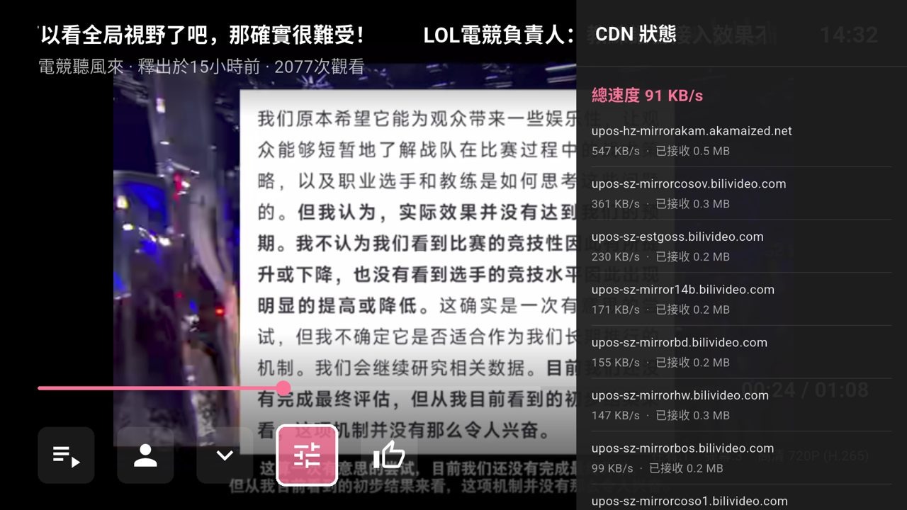
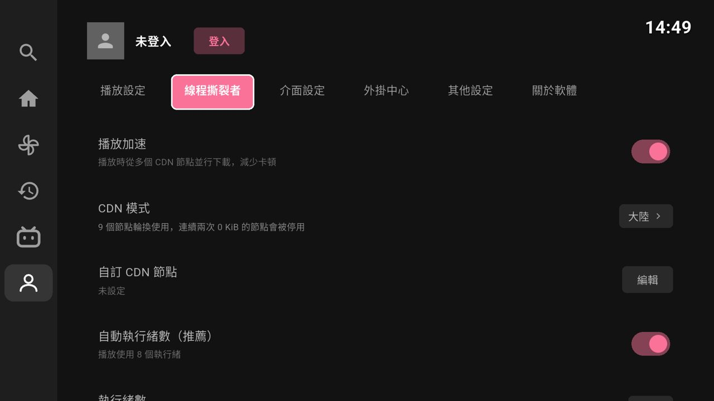
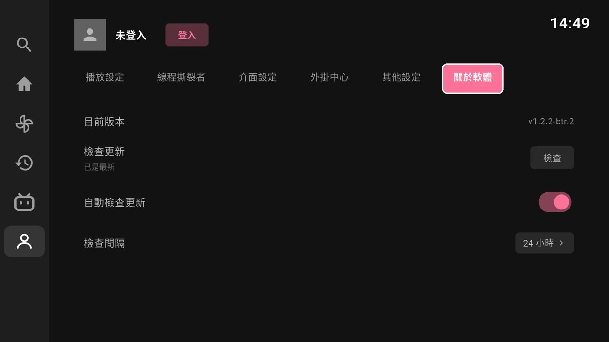

# PiliBTRTV

English | [繁體中文](README.zh-TW.md)

An unofficial third-party Bilibili client for Android TV, based on [BiliTV](https://github.com/Hyper-Beast/BiliTV) (Flutter), with BTR (Bilibili Thread Ripper) multi-CDN parallel acceleration from [PiliBTR](https://github.com/gordonpow/PiliBTR).

## Download

Download the latest APK from [Releases](https://github.com/gordonpow/PiliBTRTV/releases) and install it on your Android TV or TV box.

- Which APK to choose:
  - `PiliBTRTV-<version>-arm64-v8a.apk`: most modern TVs and TV boxes.
  - `PiliBTRTV-<version>-armeabi-v7a.apk`: older 32-bit systems.
  - The in-app updater picks the right one automatically.
- The applicationId is `com.gordonpow.pilibtrtv`, so it can be installed alongside the original BiliTV.
- Since v1.2.2-btr.2, the app checks for new versions automatically and can download and install updates within the app.

## Features

### BTR Multi-CDN Acceleration

Bilibili normally fetches a video from a single CDN node over a single connection, so playback stutters when that node is slow (more often outside mainland China). PiliBTRTV starts a local proxy inside the app (`127.0.0.1`), splits each player request into small chunks, downloads them from several CDN nodes at the same time, and hands the data back to the player in order.

- **CDN mode**: Mainland China, Overseas, or Custom (up to 32 nodes). On first launch the default follows the system language: Traditional Chinese or Taiwan, Hong Kong, and Macau use "Overseas"; other Chinese locales use "Mainland China".
- **Thread count**: Auto (8 threads for playback) or manual, from 4 to 128.
- **Fault tolerance**: Within a video, a node is disabled after it returns 0 bytes twice in a row. If all nodes are disabled, they are all re-enabled.
- **CDN status**: During playback, check the total speed and the speed and traffic of each node in the settings menu.
- Settings: Settings → BTR (線程撕裂者). Turning off "playback acceleration" returns to the original direct playback from Bilibili.

 

### Language

- The UI uses Taiwan Traditional Chinese terminology.
- Switch the language in Settings → Interface → Language: follow system, 繁體中文, 簡體中文, or English. The English language pack is downloaded from GitHub the first time you select English (internet connection required) and is updated automatically. Restart the app to apply the change.
- Content from Bilibili (video titles, UP主 names, danmaku, and so on) is not translated.

 

### Auto-update

- Checks GitHub Releases for new versions when the app starts and when it returns to the foreground. The check interval is configurable (default 24 hours).
- When a new version is available, a red dot appears in the settings sidebar and in "About". Press "Download and install" to update.

 

### Other

- **Remote control**: The directional keys, OK, and Back keys operate all features.
- **Search**: Use the in-app alphanumeric keyboard, or press OK in the search box to open the TV's system input method and type Chinese (Zhuyin, Pinyin, or voice, depending on the input methods installed on your TV).
- **Usable without logging in**: Search, playback, and settings do not require login. To log in, go to "Me" and press "Log in", then scan the QR code with the Bilibili mobile app.
- Features inherited from the original BiliTV: DASH playback (H.264 / H.265 / AV1), multiple quality levels, danmaku, playback progress memory, auto-play next, fast-seek preview, following feed, watch history, live streams, and plugins (sponsor skip, ad removal, danmaku masking).

## Development

- Flutter 3.47.9, Dart, ExoPlayer (`video_player`), `dio`, and `shared_preferences`.
- Build: `flutter build apk --release`. The Gradle wrapper is 9.1.0 and works with the JDK 25 bundled with Android Studio.
- Emulator: use an Android TV API 36 (x86_64) image. API 33 TV images only provide 32-bit x86, which Flutter does not support.

| Module | File |
|---|---|
| BTR playback proxy | `lib/services/btr/btr_proxy.dart` |
| CDN node pool | `lib/services/btr/btr_cdn.dart` |
| BTR settings | `lib/services/btr/btr_config.dart` |
| Chinese conversion | `lib/utils/zh_convert.dart`, `assets/zh/` |
| Auto-update | `lib/services/update_service.dart` |

Development log: see [`docs/PROJECT_LOG.md`](docs/PROJECT_LOG.md).

## Credits & License

- Base project: [BiliTV](https://github.com/Hyper-Beast/BiliTV) (Hyper-Beast).
- The BTR implementation is ported from [PiliBTR](https://github.com/gordonpow/PiliBTR) (GPL v3). Its behavior is based on [Bilibili-thread-ripper-desktop](https://github.com/MrTangLuyao/Bilibili-thread-ripper-desktop) (MIT).
- Chinese conversion dictionaries come from [OpenCC](https://github.com/BYVoid/OpenCC) (Apache-2.0).
- This is an unofficial third-party client and is not affiliated with Bilibili. High-quality video requires login, and paid content is not supported.
