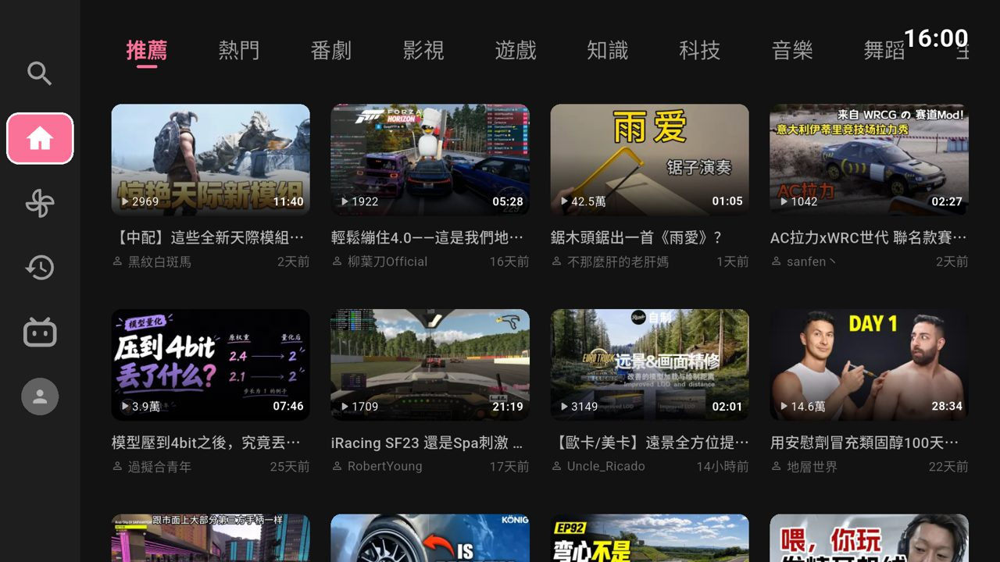
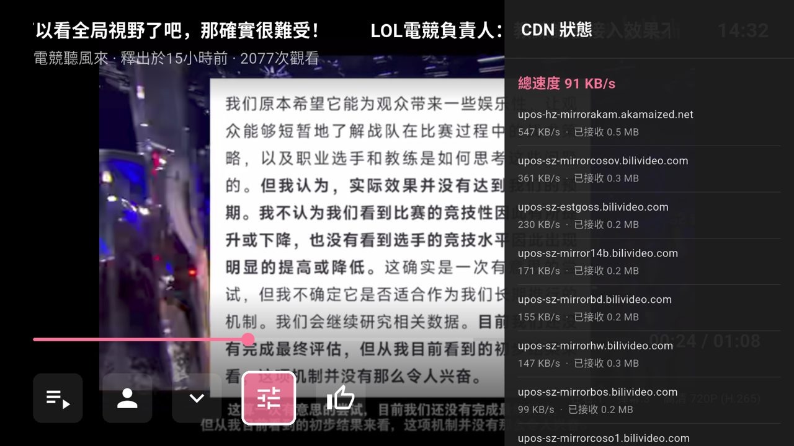
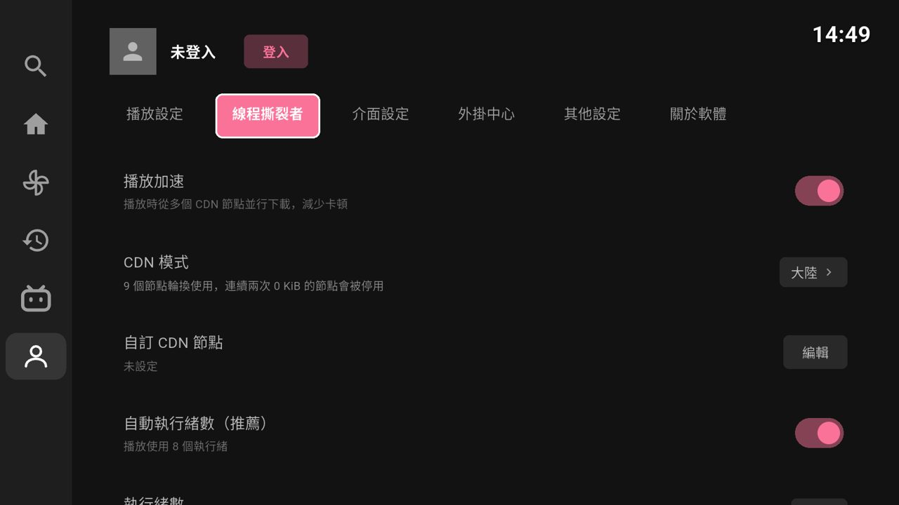
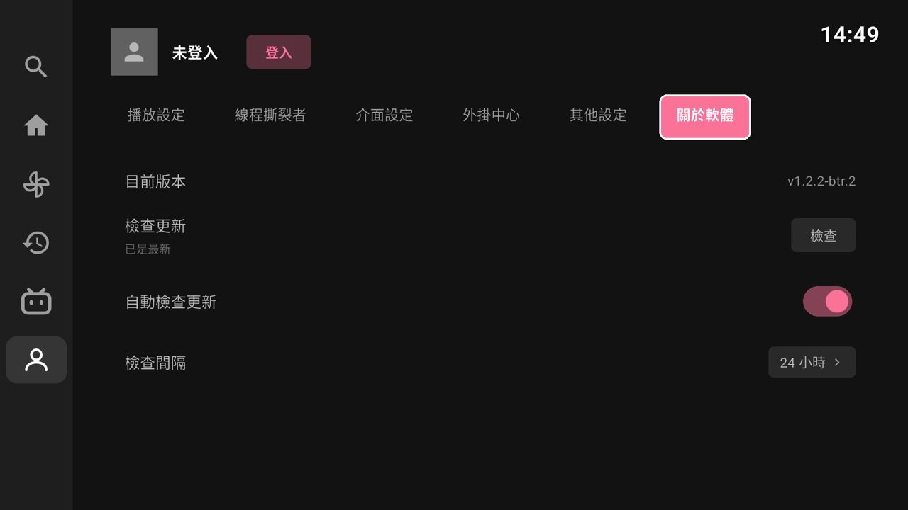

# PiliBTRTV

[English](README.md) | 繁體中文

Android TV 版第三方 Bilibili 用戶端。以 [BiliTV](https://github.com/Hyper-Beast/BiliTV)（Flutter）為基底，加入手機版 [PiliBTR](https://github.com/gordonpow/PiliBTR) 的「線程撕裂者」（Bilibili Thread Ripper，BTR）多 CDN 播放加速。

## 下載

到 [Releases](https://github.com/gordonpow/PiliBTRTV/releases) 下載最新的 APK，安裝到 Android TV 或電視盒。

- applicationId 為 `com.gordonpow.pilibtrtv`，可與原版 BiliTV 同時安裝。
- 從 v1.2.2-btr.2 起，App 會自動檢查新版本，並可在 App 內下載安裝。

### F-Droid

也可以從自架的 F-Droid 套件庫安裝與更新（APK 與 GitHub Releases 相同、同一個簽章，兩邊可以互相覆蓋更新，不必重裝）：

- 套件庫網址：`https://gordonpow.github.io/fdroid/repo`
- 指紋（SHA-256）：`C721B842CCD732752B83521BCA679B59E8320645F3E39224A8A59BEB9511B9F4`
- 一鍵加入：<https://gordonpow.github.io/fdroid/repo?fingerprint=C721B842CCD732752B83521BCA679B59E8320645F3E39224A8A59BEB9511B9F4>

## 功能

### BTR 多 CDN 播放加速

B站預設只從一個 CDN 節點、用一條連線抓影片，節點慢時就會卡頓（海外更明顯）。PiliBTRTV 在 App 內建立本機代理（`127.0.0.1`），把播放器的每個請求切成小塊，同時交給多個 CDN 節點下載，再依序交回播放器。

- **CDN 模式**：大陸、海外、自訂（最多 32 個節點）。首次啟動依系統語言預設：繁體中文或台灣、香港、澳門用「海外」，其他中文用「大陸」。
- **執行緒數**：自動（播放用 8 個）或手動 4 到 128。
- **容錯**：同一部影片中，節點連續兩次回傳 0 bytes 就停用；全部停用時重新啟用。
- **CDN 狀態**：播放時在設定選單查看總速度，以及每個節點的速度與流量。
- 設定位置：設定 → 線程撕裂者。關閉「播放加速」即回到原版的直連播放。

 

### 語言切換：繁體中文、簡體中文、English（英文語言包線上下載）

- 介面使用台灣繁體用語（影片、設定、軟體…）。
- 設定 → 介面設定 → 語言：跟隨系統、繁體中文、簡體中文、English，選定後重新啟動生效。第一次選 English 會從 GitHub 下載語言包（需要網路），之後每 7 天自動檢查更新。B 站的內容（影片標題、彈幕、留言）不翻譯。
- 影片標題、UP 主名稱、彈幕等伺服器內容在顯示時轉換字形，資料本身不變。

 

### 自動更新

- 從 GitHub Releases 檢查新版本：App 啟動、回到前景時檢查，間隔可設定（預設 24 小時）。
- 有新版本時，設定側欄與「關於軟體」顯示紅點，按「下載並安裝」即可更新。

 

### 其他

- **遙控器操作**：方向鍵、確認鍵、返回鍵即可操作全部功能。
- **搜尋**：可用 App 內的英數鍵盤，也可在搜尋框按確認鍵開啟電視的系統輸入法打中文（注音、拼音或語音，依電視安裝的輸入法而定）。
- **未登入也能使用**：搜尋、播放、設定不需登入；登入請到「我的」按「登入」，用 B站手機 App 掃描 QR Code。
- 原版 BiliTV 的功能：DASH 播放（H.264／H.265／AV1）、多畫質、彈幕、播放進度記憶、自動連播、快進預覽、動態、觀看歷史、直播、插件（空降助手、去廣告、彈幕遮蔽）。

## 開發

- Flutter 3.47.9、Dart、ExoPlayer（`video_player`）、`dio`、`shared_preferences`。
- 建置：`flutter build apk --release`。Gradle wrapper 為 9.1.0，可搭配 Android Studio 內建的 JDK 25。
- 模擬器：請用 Android TV API 36（x86_64）映像檔；API 33 的 TV 映像檔只有 32 位元 x86，Flutter 不支援。

| 模組 | 檔案 |
|---|---|
| BTR 播放代理 | `lib/services/btr/btr_proxy.dart` |
| CDN 節點池 | `lib/services/btr/btr_cdn.dart` |
| BTR 設定 | `lib/services/btr/btr_config.dart` |
| 繁簡轉換 | `lib/utils/zh_convert.dart`、`assets/zh/` |
| 自動更新 | `lib/services/update_service.dart` |

開發紀錄見 [`docs/PROJECT_LOG.md`](docs/PROJECT_LOG.md)。

## 來源與授權

- 基底：[BiliTV](https://github.com/Hyper-Beast/BiliTV)（Hyper-Beast）。
- BTR 實作移植自 [PiliBTR](https://github.com/gordonpow/PiliBTR)（GPL v3），行為參考 [Bilibili-thread-ripper-desktop](https://github.com/MrTangLuyao/Bilibili-thread-ripper-desktop)（MIT）。
- 繁簡轉換字典來自 [OpenCC](https://github.com/BYVoid/OpenCC)（Apache-2.0）。
- 本專案為第三方用戶端，與 Bilibili 官方無關。高畫質需登入，付費內容不支援。
